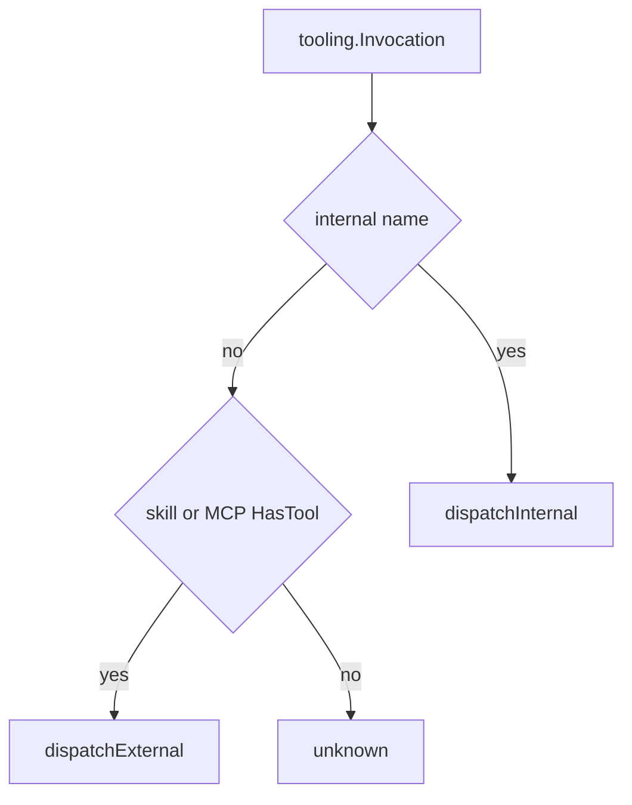

# Native tools

## Purpose

Built-in OpenAI function tools implemented in Go (plan and build sets), plus routing to skills and MCP. Invocations are parsed via `internal/tooling` and executed through `tools.Exec`.

## Packages and files

| File area | Tools / role |
|-----------|----------------|
| `create_plan.go`, `edit_plan.go`, `build_plan.go` | Plan mode |
| `shell.go`, `read_file.go`, `edit_file.go`, `find.go`, `filewalk.go`, `search_pool.go` | Build mode filesystem/shell/search |
| `internal/pathglob`, `internal/gitignore` | Glob `**` matching and `.gitignore` (vendored matcher) |
| `subagent.go` | Nested agent run |
| `list_sub_agents.go` | Subagent role pool listing |
| `load_skill.go`, `search_skill.go` | Skill tools |
| `fetch_web.go`, `web_search.go` | Web fetch and search |
| `deep_research.go`, `research_status.go` | Background deep research and job status |
| `docs_retrieval.go` | Embedded docs BM25 search (`docsRetrieval`) |
| `exec.go` | `Exec`, `resolveToolInvocation`, dispatch |
| `env.go` | Type alias to [`internal/agent/toolenv/Env`](../../internal/agent/toolenv/env.go) |
| `internal/agent/toolenv/` | Canonical `Env` definition (avoids import cycles) |
| `dump_*.go` | Text descriptions for system prompt |
| `internal/tooling/parse.go`, `reflect.go` | Invocation parse and reflection |

## Key functions

| Function | Behavior |
|----------|----------|
| `tools.Exec` | Entry from runtime `execTool` |
| `resolveToolInvocation` | Internal vs skill vs MCP by name |
| `dispatchInternal` | Mode-checked native handlers |
| `dispatchExternal` | `loadSkill` / `searchSkill` or `MCP.CallTool` |
| `isInternalToolName` | Fixed set of native names |

## Internal tool names

| Name | Mode |
|------|------|
| `createPlan`, `editPlan`, `buildPlan`, todos | agent when `PlanningActive` (or deferred via orchestrate) |
| `subagent` | agent (native tool_call only; not deferred / orchestrate); optional `roleProvider` + `roleModel` from `[[roles.subagent]]` |
| `listSubAgents` | agent (lists configured subagent role pool) |
| `shell`, `readFile`, `editFile`, `find`, `fetchWeb`, `webSearch`, skills | deferred (orchestrate / legacy XML) |
| `deepResearch`, `researchStatus` | chat native; deferred in agent mode (orchestrate / legacy XML) |
| `searchTools`, `orchestrate`, `switchMode` | agent |
| `fetchWeb`, `webSearch`, `switchMode` | chat |
| `customizeUI` | agent and chat; prepare and switch Solomon's frontend without restarting the daemon |

### Editing whole-line ranges

`editFile` accepts optional `startLine` and `endLine` (1-based, inclusive), matching `readFile`. Supplying either selects range editing on an existing file; the omitted bound defaults to the first or last line. `newString` is required, including an explicit empty string to delete the selected lines. Non-empty `oldString` checks the selected content before writing and may include or omit the final selected line ending. A mismatch returns `ok=false` without changing the file. Invalid, null, reversed, or out-of-bounds ranges are rejected; range editing cannot be combined with delete or rename.

The SDK adds an optional final `sdk.EditRange{StartLine: first, EndLine: last}` argument to `sdk.EditFile` and `sdk.EditFileResult`; existing calls remain valid. Zero-valued SDK bounds are omitted. A range with both bounds omitted is rejected by the SDK. Typed results include `StartLine` and `EndLine`. For example, `sdk.EditFile("file.go", expectedOld, replacement, "update function", false, sdk.EditRange{StartLine: 10, EndLine: 20})` replaces those whole lines. Use line numbers from a current read or search, not guessed offsets. Prefer `sdk.ReplaceInFile` for exact substring replacements, including changes within a line.

Unselected bytes and their line endings are preserved. The selected lines include their line terminators; when a non-empty replacement lacks a trailing newline, it inherits the last selected line's LF or CRLF ending, preventing concatenation with the next line. Explicit trailing newlines are respected, and the last line without a terminator stays unterminated unless the replacement supplies one. Empty replacements remove the entire selected span. Normal edit checkpointing and file-change tracking apply. Tool displays identify the selected line interval.

### Tool arguments and provider configuration

Dispatch validates a JSON object and non-empty intent before activating instructions or executing tools. Read/edit paths, shell commands, search queries, and fetch URLs must be non-empty strings. Explicit numeric bounds, timeouts, and result limits must be positive integers rather than null, strings, or negative values; reversed line ranges are rejected. Existing positive upper-limit clamping remains unchanged. Supplied edit text must be a string, delete must be boolean, and search extras must be an object. Errors retain the underlying missing-intent sentinel where applicable.

`validation.Issue` separates `arguments`, `configuration`, and `policy` errors, including component and field names without copying supplied values. These categories are logged and retained in orchestration tool-error summaries. Legacy search configuration is checked after merging configured values with per-call extras: Brave/Bing need apiKey, Google PSE also needs cx, and SearxNG needs an absolute HTTP(S) baseURL. Missing/blank settings and malformed endpoints fail before network calls. Wrong value types are argument errors. An explicitly unknown engine is an argument error; an unknown configured engine or unavailable internal search runtime is a configuration error. No credentials, engine selection, or configuration files are changed automatically.

### Failure classification

Build failures carry `error_kind`, `phase`, `retryable`, and `retry_action`. Source syntax/type errors retain `error_type=compile_error`, `phase=compile`, and the `compile_error` field; their precise parse/build step is in `stage`, and `retry_action=fix_source` allows the bounded source-repair loop. Toolchain, filesystem, dependency, network, timeout, and cancellation failures have distinct error types and do not enter that loop. `fix_environment` requires setup repair; `retry_build` denotes a transient build failure without authorizing workspace replay. Typed build errors preserve their underlying cause for `errors.Is`/`errors.As`.

Execution failures distinguish runtime, IPC protocol, cancellation, and timeout errors and return `retryable=false` with `retry_action=inspect_execution`: a possibly executed script must not be blindly replayed. Individual tool-error summaries also include `category`, in addition to the transport/result kind. Unknown compiler failures are conservatively treated as environment failures rather than inventing a source correction.

### Orchestration outcomes

Runtime results distinguish script completion from host-call outcomes. `status=success` and `ok=true` mean the script finished normally and no observed host tool reported failure. `status=partial`, `script_ok=true`, and `ok=false` mean the script finished but at least one host call failed. `status=error` and `script_ok=false` mean the script itself failed. Build and execution failures also include the classification described above.

Host errors, non-zero shell exit codes, shell launch errors, top-level `ok=false`, `isError=true`, and non-empty top-level `error` results are counted. The result includes `observed_tool_calls`, `successful_tool_calls`, `failed_tool_calls`, and up to sixteen `tool_errors` entries containing the observed completion number, tool name, kind, and a bounded message. Additional entries set `tool_errors_truncated=true` while retaining the full failure count. Arguments and shell output are not copied into these summaries. Counters are scoped to one orchestration invocation; observed calls can span worker IPC recovery attempts, while the legacy `tool_calls` field describes the final worker run.

Caught or printed errors remain visible as partial results. Later calls can still run, including deliberate fallback operations; partial results do not automatically replay scripts or mutations. The model must explain whether a fallback completed the task or a failure remains. Tool summaries prioritize partial/error status over optimistic script output. This reporting uses structured host results, not keyword searches in stdout or arbitrary nested data, and cannot detect errors swallowed inside a shell command that returns exit code zero or purely local Go mistakes caught by the script.

Shell process startup failures now return a non-zero sentinel exit code (`-1`) so SDK callers receive an error. Worker logging is disabled on the IPC stdout channel; a script panic is returned through the JSON protocol instead of corrupting it with console log lines.

### Orchestration input strings

`orchestrate` accepts optional `inputs`, an object mapping names to plain-text strings. Keep regexes, replacement text, complex commands, and multiline content there instead of embedding them in Go literals. JSON escaping still applies once to the API request; do not add Go escaping to input values. Existing content should normally be read through the SDK.

For example, supply `"inputs": {"pattern": "\\d+\\.txt"}` in the JSON request, and obtain the literal regex with `pattern, err := sdk.Input("pattern")` inside `main()`. Check the error before passing the value to a search helper. The accessor is local, requires no intent, and does not issue a host tool call. Missing keys return an error; empty values remain valid.

The compiler creates a separate initialization file using `strconv.Quote` for both keys and values. This preserves backslashes, quotes, backticks, newlines, Unicode, and NUL characters without treating payload text as executable Go. Inputs belong to one WASM invocation and do not leak into later runs. Supplying inputs does not repair invalid source: syntax failures still return `compile_error`, with up to eight structured diagnostics (`line`, `column`, `message`, optional `hint`) and input guidance. Existing valid Go escapes keep their original semantics.

### Go compilation diagnostics

Source compilation failures include up to eight structured diagnostics. Compiler messages retain their original text and source position, with a category and recovery hint for imports, undefined symbols, repeated `:=`, unused variables, function return counts, and SDK signatures. Syntax errors continue to use parser diagnostics. The tool description and discovery guidance explain explicit imports, Go string functions, `strings.Index` versus `strings.Cut`, and signature discovery. Diagnostics do not rewrite source or execute a partially compiled script. Regression coverage is in test/go_diagnostics_test.go.

### Go-only orchestration

Orchestration logic belongs in Go and the SDK: JSON parsing, filtering, calculations, and file transformations must not be delegated to generated Python, JavaScript, or other interpreter programs. Project source files may still use their target language, and existing project test/build entrypoints remain runnable. Moving orchestration code into a temporary file or encoded payload is also prohibited by the tool contract.

`internal/sandbox/shellpolicy` validates all model-invoked shell tools, including deferred/legacy dispatch without an orchestrate parent, before instruction activation or process creation. User-entered terminal commands use a separate path. It rejects recognized inline interpreter invocations (including eval flags, stdin, pipelines, common launchers, and remote SSH commands), heredocs, backtick substitutions, dynamic executable names, and nested shell eval commands. Ordinary `$(...)` substitutions are recursively validated when used as argument values; substitution-generated executable names are rejected. Simple shell counters are supported; arithmetic containing command substitutions or dynamic expansions is rejected. Normal host commands and existing script/test entrypoints are supported. The validator is a command-policy check, not a complete shell interpreter or an isolation boundary: it does not inspect arbitrary project scripts or executable aliases. The same Go-only rule is included in the agent template, orchestration tool descriptions, and SDK discovery responses.

The policy also examines common indirect launchers: xargs, find -exec/-execdir/-ok, docker/podman run/exec (including entrypoint and compose), kubectl exec, env split-string, leading redirections, and SSH command-bearing options. It rejects shell alias/source/eval setup and encoded inline preload programs. Unknown launcher options are conservatively rejected. Once an actual project script is selected, its arguments remain data; for example, node file.js -e expected is distinct from node -e code. Python warning/implementation options and Node preloads are parsed before the script boundary.

This remains a preventive command check rather than a security sandbox. It does not inspect arbitrary script contents, existing shell startup configuration, custom executables, unrecognized executable aliases, container image behavior, or project runner configuration. Those can execute code outside the visible command. A stronger guarantee would require a narrower execution surface or process isolation, not additional keyword matching.

Regression coverage is in test/orchestrate_shell_policy_test.go, test/shell_wrappers_test.go, and test/argument_configuration_test.go, including rejected compound commands that must not create marker files.

### Image reads

`readFile` recognizes PNG, JPEG, and WebP by their binary signatures, including files without an extension. `sdk.ReadFile(path, intent)` automatically attaches the image to the orchestrate result even when the script does not print its return value. The returned string describes the image; `sdk.ReadFileInfo` also exposes `Type`, `MIMEType`, `Width`, `Height`, and `SizeBytes`. Existing text reads and their line ranges retain their behavior. Image reads reject line ranges, malformed image headers, and files larger than 5 MiB.

Attachments bypass textual tool-output truncation and are saved as byte snapshots in the message's `tool_images` field, so replay survives source-file edits or deletion. OpenAI-compatible requests send image content in a user message after the complete batch of tool replies; Anthropic embeds image blocks inside the corresponding `tool_result`. Cursor Sub sends native MCP image content items and replays tool images as visual history messages. The selected model must support vision; Solomon does not infer model capabilities from model names.

### `subagent` arguments and results

`subagent` is a native function tool in agent mode. It accepts `run_in_background` for a persisted asynchronous run, `reasoningEffort` for a per-run override, and `interrupt` together with `resume` to cancel the active run before adding a new task. `/subagent stop` and `/subagent cancel` also cancel the live background context before persisting its final status.

| Argument | Required / default | Behavior |
|----------|--------------------|----------|
| `sysPromptPath` | Required for a new run | Prompt template path; inherited project instructions are merged into a custom prompt |
| `task` | Required for a new run | Concrete task; when resuming, an optional task is appended to the stored transcript |
| `resume` | Omitted | Existing `subchatId` to continue instead of creating a new session |
| `run_in_background` | `false` | `false` waits for output; `true` returns `subchatId` and `status=running` immediately |
| `interrupt` | `false` | Requires `resume`; cancels the active resumed run before applying the new task |
| `reasoningEffort` | `subagent_reasoning_effort` | Per-run override: `none`, `low`, `medium`, `high`, `xhigh` (extra high), or `max` |
| `roleProvider`, `roleModel` | Omitted | Select a configured `[[roles.subagent]]` provider/model pair; both are required together |

The tool returns `{ok, output, subchatId, status}` on success. Synchronous runs normally finish with `status=done` and include `output`; background runs return immediately with `status=running`. Timeout, cancellation, and recoverable nested errors persist the partial transcript with `status=paused` where possible. `subagent` is not exposed through `searchTools` and cannot be invoked from an `orchestrate` script.

Skill tools: `loadSkill`, `searchSkill`. MCP catalog entries use stable names (`MCP.<server>.<tool>`) and are invoked from `orchestrate` through `sdk.mcp.<tool>(intent, args)`.

Deep research follows the same surface split: chat receives native
`deepResearch` and `researchStatus` schemas, while agent mode discovers the
deferred entries through `searchTools` and executes them through `orchestrate`.
The asynchronous lifecycle, persistence, and GUI report surface are described
in [Deep research](research.md).

## Subagent roles

When `[[roles.subagent]]` is configured in `config.toml`, the primary agent can delegate nested runs to cheaper models:

| Step | Tool / args |
|------|-------------|
| Discover pool | `listSubAgents` — returns `provider`, `model`, `description`, and manually configured `scores` for the selected characteristics |
| Spawn nested run | `subagent` with optional `roleProvider` + `roleModel` matching a pool row |
| Fallback | Omit both role fields → nested run uses the session provider and model |

Role rows are validated on **config load and save**: provider must exist in `[providers]`, the provider API must be reachable, and the model id must appear in that provider’s model list (`ListModelsForProviderAll`, same path as `/models`). Runtime `subagent` calls also require `roleProvider` + `roleModel` to match a configured pool row (`listSubAgents`). Invalid pairs are rejected with a hint to call `listSubAgents`. Resume and deferred nested spawns restore `role_provider` / `role_model` from the subsession or pending spawn payload when omitted.

Config schema: [`config.Roles`](../../internal/config/roles.go). Manual table model: [`internal/roles/table.go`](../../internal/roles/table.go).

## `editFile` semantics (build)

| Args | Behavior |
|------|----------|
| `oldString` non-empty, `newString` any | Replace **one** occurrence of `oldString` with `newString` |
| `oldString` empty, `newString` non-empty, `delete` false/absent | Create or overwrite file at `path` |
| `delete: true` | Remove file at `path` (`oldString` / `newString` ignored) |
| `renameTo` non-empty | Move/rename `path` to `renameTo`; `oldString`, `newString` empty; `delete` false; destination must not exist |
| `oldString` and `newString` both empty, `delete` false/absent, `renameTo` empty | Rejected (`editFile refuses empty overwrite`) |

All variants require non-empty `intent`. Paths are relative to the project root. With the Cursor sidecar, `Delete` maps to `editFile` with `delete: true` — see [Cursor integration](cursor-integration.md).

`editFile` mutations are recorded for checkpoint file staging; `/goto` restores the workspace for staged paths (byte snapshots under the session `staging/` directory).

## `find` semantics (build)

| Args | Behavior |
|------|----------|
| `files=true`, `pattern` | Glob listing of matching paths under `path` (default `.`), sorted by mtime descending; respects `.gitignore` |
| `files=false`, `pattern` | Go regexp content search; optional `pathGlob`, `outputMode` (`content`, `files_with_matches`, `count`), context lines, `headLimit`, `caseInsensitive`, `multiline` |
| `timeoutSeconds` | Optional per-call timeout (default 60s) |

Cursor `Grep`, `Glob`, and `SemanticSearch` map to `find` via the sidecar bridge ([Cursor integration](cursor-integration.md#tool-name-bridge)); semantic queries today use regexp fallback.

## Router flow

Legacy XML invocations (when `[tools].legacy` is enabled) are parsed by [`internal/tooling/legacy_xml.go`](../../internal/tooling/legacy_xml.go) and [`legacy_stream.go`](../../internal/tooling/legacy_stream.go); tool names are validated against the active native + MCP tool set before execution.

| Config | Request carries API tool schemas | Parser accepts |
|--------|----------------------------------|----------------|
| default | yes | native `tool_calls` |
| `legacy` | yes | native or `<tool_calls>` XML |
| `legacy_force` | no | `<tool_calls>` XML only |

## `toolenv`

Passed into every native tool via [`tools.Exec`](../../internal/agent/tools/exec.go). The struct is defined in [`internal/agent/toolenv/env.go`](../../internal/agent/toolenv/env.go) and re-exported as `tools.Env` in [`tools/env.go`](../../internal/agent/tools/env.go). Runtime builds it per invocation in [`Runtime.toolEnv(inv)`](../../internal/agent/runtime/exec.go), including the invocation's checkpoint sequence so concurrent edits remain associated with the right tool call.

| Field | Purpose |
|-------|---------|
| `ProjHex`, `ProjRoot` | Workspace identity and root for relative paths |
| `Cfg` | Loaded TOML (web search, tool output limits) |
| `MCP` | MCP manager for external tool calls |
| `RunNested`, `RunNestedWithSystem` | `subagent` nested turn |
| `SetMode`, `CurrentMode` | Plan vs build mode switches |
| `Checkpoint*` callbacks | File staging for `/goto` after `editFile` |
| `ActivateInstructions*`, `MergeInstructionBlock` | `AGENTS.md` activation from `readFile` / `shell` |

To add a new callback: extend `toolenv.Env`, wire it in `runtime/exec.go`, use it from the tool handler. See [Package index — toolenv](package-index.md#toolenv--tool-execution-context).

## Extension points

1. Add `*OpenAI()` schema builder and exec handler.
2. Register name in `isInternalToolName` and `dispatchInternal`.
3. Add to `NativeToolParams` for the correct mode.
4. Update plan or build tool dump.

## Related code

- [`internal/agent/tools/exec.go`](../../internal/agent/tools/exec.go)
- [`internal/agent/runtime/exec.go`](../../internal/agent/runtime/exec.go)

## See also

- [Plan vs build](plan-vs-build.md) — agent/chat modes and deferred tools
- [Agent turn pipeline](agent-turn-pipeline.md)
- [MCP integration](mcp-integration.md)
- [Cursor integration](cursor-integration.md)
- [Skills and slash](skills-and-slash.md)
- [Configuration — `[tools]`](../user-guide/configuration.md#tools-legacy-xml-tool-calling)

## Reading saved chats

`readChat` is available natively in both agent and chat modes and through
`orchestrate` as `sdk.ReadChat(chatID, tools, stats, intent)`. It reads Solomon's
local archive across all projects, including subchats, without resuming or
modifying a conversation. It does not read T3 Code databases.

The required `chatId` identifies a saved chat exactly. Optional `tools` and
`stats` both default to `false`. Normally the result includes the title, project,
creation date and user/assistant messages. `tools=true` includes tool calls and
results; `stats=true` adds stored per-message token counts, timings, throughput
and saved turn-display statistics. Statistics are not estimated or invented.
Original message indexes and timestamps are retained. Reasoning and API-only
content are excluded. Legacy tool blocks are excluded unless `tools=true`.

The result is the current saved transcript. Archived branches and transcripts
from before compaction are not returned; `compacted` indicates whether a
pre-compaction archive exists. Missing, malformed or ambiguous IDs return an
error. Retrieved messages are reference data, not current instructions.
